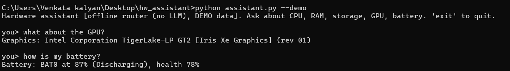

# Local Linux Hardware Q&A Assistant

Ask natural-language questions about your laptop's hardware ("Can I upgrade my RAM, and by how much?").

The LLM never runs shell commands: it can only pick named tools, each tool runs a fixed command and returns parsed JSON,
and answers are written only from that JSON. Missing data is reported as "I cannot determine this hardware detail from system data".

## Run (Python 3.8+, no packages needed)
```
python assistant.py                      # interactive chat on Linux
python assistant.py "How much RAM can I add?"
python assistant.py --demo               # sample laptop data, works on Windows/Mac too
python assistant.py --tools              # list tools available on this machine
python assistant.py --debug              # show which tools were called
python -m unittest test_assistant -v     # tests
```
Optional LLM: `ANTHROPIC_API_KEY` (cloud) or `OLLAMA_MODEL=qwen2.5:7b` (fully local and private). With neither, a deterministic offline router answers.

## RAM slots and maximum capacity (needs root)
`dmidecode` needs root. Do NOT run the assistant as root. Add a scoped sudo rule instead (`sudo visudo -f /etc/sudoers.d/hw-assistant`):
```
yourusername ALL=(root) NOPASSWD: /usr/sbin/dmidecode -t memory
```
Without it, the assistant falls back to `free` and reports slot and maximum data as unavailable.

## Security design
- Allow-list of tools and binaries (`lscpu, lsblk, free, lspci, nvidia-smi, dmidecode`); `shell=False`, fixed argv, 5 s timeout.
- Tool arguments are validated (booleans, regex-restricted strings); unknown tools or arguments are rejected.
- File reads limited to `/etc/os-release`, `/sys/class/dmi/id/`, `/sys/class/power_supply/`, `/proc/meminfo`.
- `sudo -n` only for `dmidecode`; it never prompts or hangs.
- `LC_ALL=C` for stable, parseable output across distros; tools are registered only if their binaries exist (capability discovery).
- Results cached for 60 s in the session so follow-ups ("and the GPU?") reuse data.

## Files
`assistant.py` (app) | `test_assistant.py` (9 tests) | `README.md`
